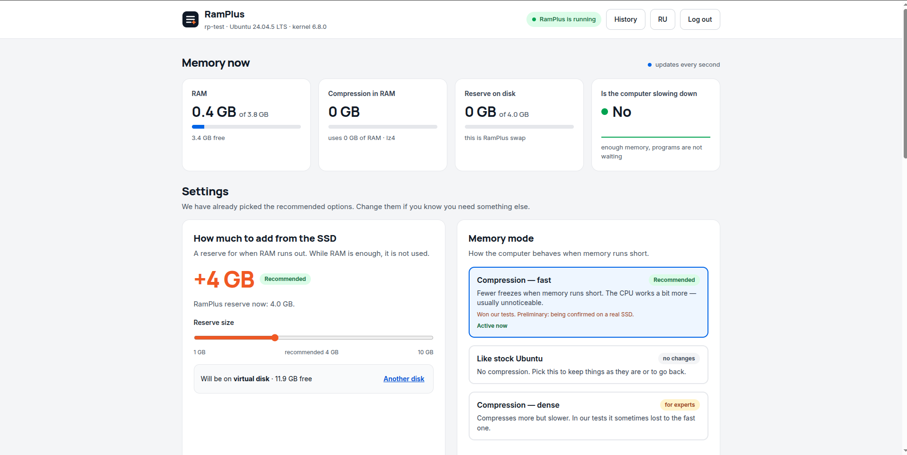
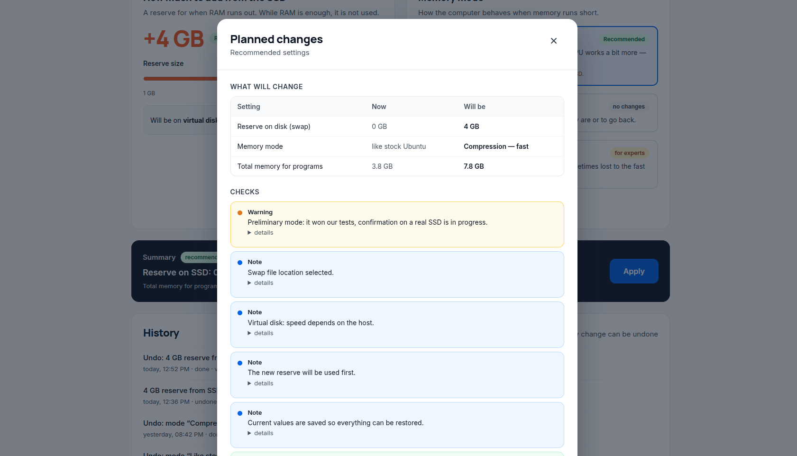

<p align="center">
  
</p>

<h1 align="center">RamPlus</h1>

<p align="center">
  <b>Stop Linux from freezing when it runs out of memory.</b><br>
  Simple, honest memory extension for Linux: SSD-backed swap, zswap and safe tuning —<br>
  with a web UI, a CLI, and one-click undo for every change.
</p>

<p align="center">
  <a href="https://github.com/ashot0907/RamPlus/actions"></a>
  <a href="LICENSE"></a>
  
</p>

<p align="center">
  
</p>

> **Status: alpha.** It works and is covered by tests on real systems, but it has not been used by many people yet.
> Please try it on a machine you can afford to reboot, and tell us how it went.

---

## The problem

You open one Chrome tab too many, start a Docker build, or load a big model — and your Linux desktop
**freezes**. The mouse stops moving. A minute later the kernel kills something, often the thing you
were working on.

Linux already has every tool needed to handle this well: swap, compressed swap (zswap), memory
pressure metrics (PSI), cgroups. But the defaults are conservative, the knobs are scattered across
`/proc`, `/sys`, `fstab` and systemd, and getting them wrong can make things worse.

**RamPlus puts all of that behind one screen:** see what your memory is doing, pick how much SSD
space to use as a safety reserve, choose a memory mode, review exactly what will change, and apply.
If you don't like the result, undo it with one click.

## What RamPlus is — and what it is not

**It is:**

- a friendly way to give your system **extra memory headroom on your SSD** (swap), sized for your machine;
- a way to turn on **memory compression** (zswap), which in our tests turned multi-second freezes into
  millisecond hiccups;
- a **safety net**: every change is planned, checked, logged and reversible.

**It is not:**

- **not magic RAM.** An SSD is about 1000× slower than RAM. RamPlus does not make your computer
  faster when it already has enough memory. It helps when memory runs out: programs keep working
  instead of crashing, and the system stays usable instead of freezing.
- **not a "RAM booster".** It doesn't "clean" or "free" memory. It configures standard Linux kernel
  features — the same ones you could set by hand — and shows you every command it runs.
- **not a GPU memory (VRAM) extender.**

## How it works, in one picture

```
            fast                                         slower, only when needed
 ┌──────────────────────┐    ┌──────────────────────┐    ┌──────────────────────┐
 │  RAM                 │ →  │  Compressed RAM      │ →  │  Swap on your SSD    │
 │  active programs     │    │  (zswap)             │    │  (RamPlus swapfile)  │
 │                      │    │  2–3× more fits      │    │  safety reserve      │
 └──────────────────────┘    └──────────────────────┘    └──────────────────────┘
```

When RAM fills up, the kernel moves memory that hasn't been touched for a while out of RAM.
With zswap enabled, it is first **compressed and kept in RAM**; only what doesn't fit goes to the
SSD. Your active programs keep the fast RAM, and the system doesn't stall waiting for the disk.

RamPlus does not replace the kernel's logic. It sets it up correctly, keeps it set up across reboots,
and shows you what's happening.

## Features

- **Live memory dashboard** — RAM, compressed memory, swap and a plain-language answer to
  *"is my computer slowing down because of memory?"* (based on kernel PSI metrics).
- **Recommended settings out of the box** — RamPlus suggests a swap size and a memory mode for
  *your* machine. Change anything, or just press **Apply**.
- **Plan before apply** — before anything changes, you see a table "now → after", every safety
  check, and every technical step.
- **One-click undo** — every operation is recorded in a journal and can be rolled back. Before
  undoing, RamPlus verifies the system is in the state it expects; if something was changed by hand,
  it stops and tells you instead of guessing.
- **Safe by default** — refuses swap on USB drives, unsupported filesystems (NTFS, exFAT, ZFS…), or
  when there isn't enough free space; warns about hibernation; never edits GRUB or the kernel
  command line.
- **Web UI and CLI** — the same engine behind both. Web UI in English and Russian.
- **Works on servers too** — the web UI listens on `127.0.0.1` only; reach it through an SSH tunnel.

<p align="center">
  
</p>

## Quick start

> Tested on **Ubuntu 24.04**: the full integration test (every operation, the daemon and the web UI)
> runs in a VM with kernel 6.8; on kernel 7.0 only read-only commands (`status`, plans, `recommend`)
> have been checked so far. Other systemd-based distributions should work; please report your results.

### Debian / Ubuntu (.deb)

Download `ramplus_<version>_amd64.deb` from [Releases](https://github.com/ashot0907/RamPlus/releases) and:

```sh
sudo apt install ./ramplus_<version>_amd64.deb
```

The package installs the binaries, systemd units and system users, but does **not** enable or start
anything. `apt remove` refuses while RamPlus still manages swap or settings — undo them first
(History → Undo, or `sudo ramplus rollback`). An arm64 `.deb` is built too, but not tested on real
hardware yet.

### Arch Linux (AUR)

```sh
yay -S ramplus-bin        # release binaries; or "ramplus" to build from source
```

### From source

You need Go (current stable) and Node.js with npm (only to build the web UI).

```sh
git clone https://github.com/ashot0907/RamPlus.git
cd ramplus
make build
sudo make install         # into /usr/local; sudo make uninstall to remove
```

Plain binaries for amd64/arm64 (tar.gz, with `SHA256SUMS`) are on the
[Releases](https://github.com/ashot0907/RamPlus/releases) page as well.

### Open the web interface

```sh
sudo ramplus init                                   # set a password for the web UI
sudo systemctl enable --now ramplusd ramplus-web
xdg-open http://127.0.0.1:7781
```

Log in, look at the recommended settings, press **Apply**, review the plan, confirm. Done.

### Or use the terminal

```sh
ramplus status                 # what your memory is doing right now
ramplus recommend              # what RamPlus suggests for this machine

# swap + memory mode in one operation (shows the plan and asks before changing anything)
sudo ramplus setup --size 16G --existing=replace --profile zswap-lz4 --experimental

ramplus history                # everything RamPlus has done
sudo ramplus rollback          # undo the last operation
```

What `ramplus status` looks like:

```text
$ ramplus status
Memory
  Total           31.1 GiB
  Available       21.4 GiB (69%)
  Used            9.7 GiB (31%)
  Cache (Cached)  13.0 GiB
  Swap total      8.0 GiB
  Swap free       8.0 GiB
  Swap used       0 B (0%)

Swap devices
  PATH               TYPE  SIZE     USED  PRIORITY  DISK  RAMPLUS
  /ramplus.swapfile  file  8.0 GiB  0 B   -2        SSD   yes

zswap
  Enabled           yes
  Compressor        lz4
...
PSI memory (% of time waiting for memory)
              avg10  avg60  avg300
  some        0.00   0.00   0.00
  full        0.00   0.00   0.00
  assessment  normal (by some avg10)
...
```

Every command that changes swap or memory settings has `--dry-run` (show the plan only) and `--yes`
(for scripts). The CLI speaks English; for Russian use `--lang ru` or a Russian locale
(`LANG=ru_RU.UTF-8`). The web UI has both languages. Full reference: [docs/cli.md](docs/cli.md).

## Recommended settings

RamPlus suggests settings for your machine. They are pre-selected in the web UI and marked
**Recommended**.

| Setting | Recommendation | Why |
|---|---|---|
| **Swap size** | RAM ≤ 8 GB → same as RAM · 8–32 GB → half of RAM · more → 16 GB, never more than your free space allows | Enough headroom for spikes without wasting disk space |
| **Existing Ubuntu swap** | **Replace** it with the RamPlus swapfile (the old file is kept, so you can undo). Swap partitions and zram are kept, and so is a swapfile whose data would not fit into memory | One swap you control instead of two |
| **Memory mode** | **Fast compression** (zswap, lz4 + zsmalloc) — *preliminary* | Fewest freezes in our tests (see below) |

You are always free to choose differently. RamPlus shows what each choice means
("you will have exactly 16 GB" vs "8 GB Ubuntu + 16 GB RamPlus = 24 GB").

### Memory modes

| Mode | What it does | Status |
|---|---|---|
| **Fast compression** (`zswap-lz4`) | Compresses memory in RAM with lz4 before it goes to the SSD. Fewer freezes, slightly more CPU work. | Recommended · **preliminary** |
| **Like stock Ubuntu** (`default`) | No compression — exactly what Ubuntu 24.04 ships. Use it to keep or restore the original behaviour. | Standard |
| **Dense compression** (`zswap-zstd`) | Compresses harder with zstd. More fits in RAM, but compression is slower. | For advanced users |

## Our test results — and why the recommendation is "preliminary"

We stress-tested a virtual machine with 3.8 GB of RAM (kernel 6.8) running a program that needs
5 GB with all its pages constantly in use (`stress-ng --vm --vm-keep`), and measured how long a small
"interactive" process had to wait for memory (lower is better):

| Configuration | Wait, 99th percentile | Time the system was stalled (PSI full, peak) | Run took |
|---|---|---|---|
| No swap | — the program fails: not enough memory | — | — |
| Plain swap | **~67 seconds** — a full system freeze | 99 % | 69 s |
| zswap, lz4 + zsmalloc | **~8 milliseconds** | 61 % | 17 s |
| zswap, zstd + zsmalloc | **~10 milliseconds** | 52 % | 15 s |
| zswap with kernel defaults (lzo + zbud; Ubuntu ships zswap off) | ~157 milliseconds | 99 % | 129 s |

The single worst wait was about 0.16 s for every zswap configuration; the difference is in how often
long waits happen. Raw data, conditions and all workloads:
[docs/benchmarks/](docs/benchmarks/README.md).

Two honest caveats:

1. **These are virtual-machine numbers.** A VM's "disk" is cached in the host's RAM, so it does not
   behave like a real SSD. The direction of the result is clear; the exact numbers on real hardware
   will be different.
2. **Each configuration was run only once** in this series, with an older version of the
   benchmark script.

That's why the recommended mode is labelled **preliminary**, and RamPlus asks you to confirm it.
Our rule: a mode becomes **verified** only with benchmark results from real SSDs. You can help —
see [Help us verify](#help-us-verify-the-recommendation).

## Safety

RamPlus runs as root to change system settings, so it is built to be careful:

- **Plan → check → apply.** Nothing changes until you have seen the plan. If any check fails, the plan
  is blocked and nothing is touched.
- **Write-ahead journal** (`/var/lib/ramplus/state.json`). Each step is recorded *before* it runs,
  together with how to undo it. If a step fails, the steps already done are rolled back
  automatically. If the process crashes, the next run sees the unfinished operation.
- **Undo verifies first.** Rollback checks that the files, swap and kernel values are exactly what the
  journal says. If not, it refuses and lists the differences.
- **It only deletes what it created.** Files are checked for RamPlus markers and swap signatures
  before removal.
- **Minimal footprint.** One swapfile (`/ramplus.swapfile`; on btrfs in a `/ramplus-swap` subvolume), one systemd unit, one `sysctl.d` file,
  one oneshot unit for zswap settings. No GRUB, no kernel command line, no `fstab` entry for our own
  swap.
- **Web UI security.** Listens on `127.0.0.1` by default and refuses other addresses without TLS;
  argon2id password hash; session cookies with CSRF protection; login rate limiting; Host-header
  check against DNS rebinding; strict Content Security Policy; no external requests (fonts are
  bundled). The web server itself runs as an unprivileged user and talks to the root daemon through
  a Unix socket with group-based permissions.

Found a security issue? Please don't open a public issue — see [SECURITY.md](SECURITY.md).

## Using RamPlus on a server

The web UI only listens on localhost. From your own computer:

```sh
ssh -L 7781:localhost:7781 user@your-server
# then open http://127.0.0.1:7781 in your local browser
```

Or use the CLI directly over SSH. If you really need the UI on a network address, it must be served
over TLS — see [docs/web.md](docs/web.md).

## FAQ

**Will swap wear out my SSD?**
Modern SSDs are rated for hundreds of terabytes of writes. In normal desktop use swap writes are
small. With compression enabled, even less reaches the disk. Heavy, constant swapping (thrashing) is
bad for both your SSD and your patience — that's exactly the situation RamPlus is designed to avoid.

**Why not just run `fallocate`, `mkswap` and `swapon` myself?**
You absolutely can — RamPlus runs those same commands. What it adds: picking a sensible size, safety
checks (filesystem, USB, free space, hibernation), surviving reboots, configuring compression
correctly, showing what's happening, and undoing everything cleanly.

**zram or zswap?**
zram is a compressed RAM disk used as swap; zswap is a compressed cache in front of a disk swap.
RamPlus uses zswap together with an SSD swapfile, so you get both compression and a real reserve. If
your system already uses zram (as Fedora does by default), RamPlus detects it and won't stack zswap
on top of it.

**Does it work with hibernation?**
RamPlus warns you if hibernation is configured and a change could affect it. Automatic hibernation
setup is not supported yet.

**How is this different from earlyoom, systemd-oomd, zram-generator or swapspace?**
Those are good tools that each solve one piece (killing processes earlier, setting up zram, growing
swap). RamPlus focuses on configuring swap and compression safely, explaining it in plain language,
and making every change reversible. It coexists with systemd-oomd.

**How do I remove RamPlus completely?**
Undo RamPlus changes in **History** (or run `sudo ramplus swap remove` and
`sudo ramplus profile reset`), check with `ramplus swap check-clean`, then `sudo make uninstall PURGE=1`.
Choosing "Like stock Ubuntu" is not enough: it applies the `default` mode, which RamPlus still
manages. Uninstall refuses to run while RamPlus still manages swap or settings, so nothing is left
half-configured. Details: [docs/safety.md](docs/safety.md#removing-everything).

## Help us verify the recommendation

The most useful thing you can do right now: **run the benchmark on your real SSD and share the
results.**

```sh
sudo apt install stress-ng
make build-probe                               # the benchmark needs ./ramplus-probe
sudo scripts/bench.sh --i-know-this-changes-swap
```

It temporarily changes swap settings, restores them at the end, and writes `results.csv` and
`summary.md` to `./bench-results-<time>/`. Please attach them to an issue with the label **benchmark**, along with your CPU,
RAM, SSD model and distribution. Details: [scripts/BENCH.md](scripts/BENCH.md).

## Roadmap

- [x] CLI: status, swap management, memory modes, rollback, history
- [x] Daemon with a Unix-socket API and group-based permissions
- [x] Web UI with recommendations, plan dialog and one-click undo
- [x] Release pipeline: static binaries, `.deb` package, AUR PKGBUILDs (first packaged release pending)
- [ ] Verified memory modes based on real-SSD benchmarks
- [ ] Smart mode: move idle background apps to swap *before* memory runs out, and bring an app back
      when you switch to it
- [ ] Per-application priorities (keep your browser and IDE in RAM, let builds and containers yield)

## Documentation

- [CLI reference](docs/cli.md) — every command and flag
- [Daemon API](docs/api.md) — endpoints, errors, permissions
- [Web UI](docs/web.md) — setup, TLS, security details
- [How safety works](docs/safety.md) — journal, rollback, checks
- [Benchmark](scripts/BENCH.md)
- [Development](docs/development.md) — building, tests, architecture

## Contributing

Bug reports, benchmark results and pull requests are welcome. Before a PR, please run:

```sh
make test web-test lint
```

The integration test changes swap and kernel settings, so it only runs in a disposable VM:
`sudo RAMPLUS_VM_TEST=1 scripts/vm-test.sh ./ramplus`.

## License

[Apache-2.0](LICENSE)
